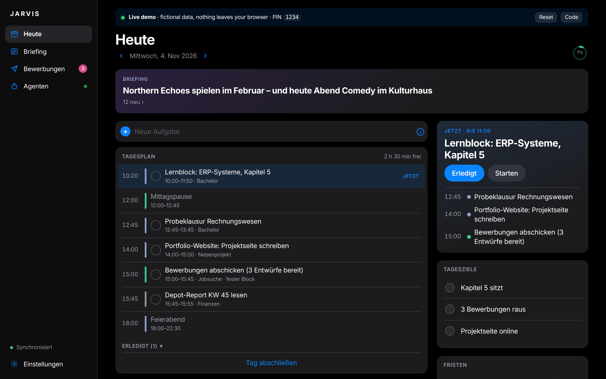
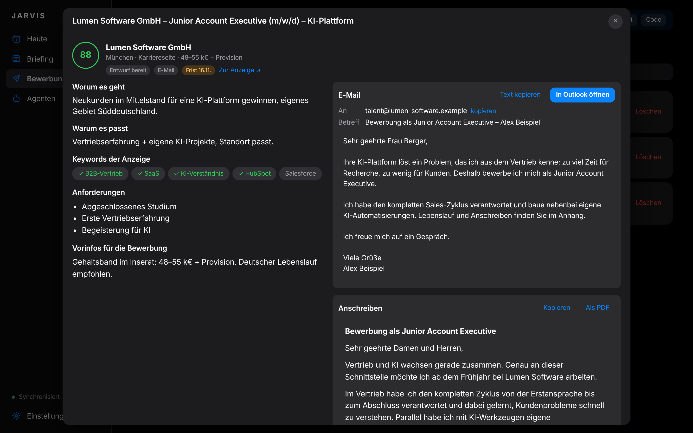
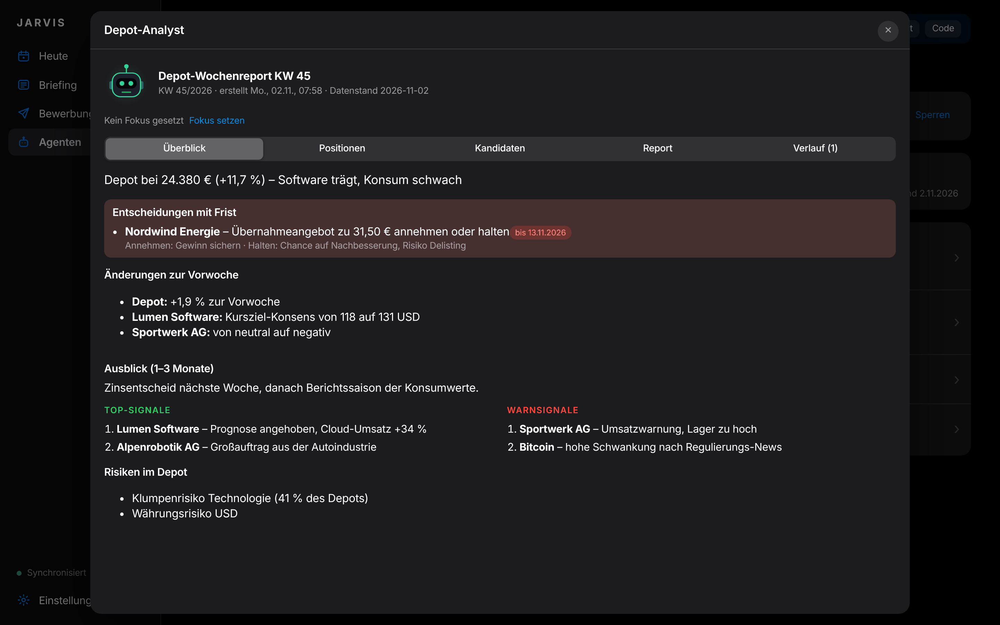
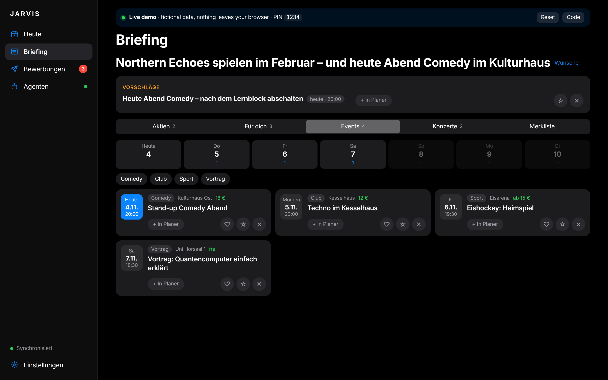
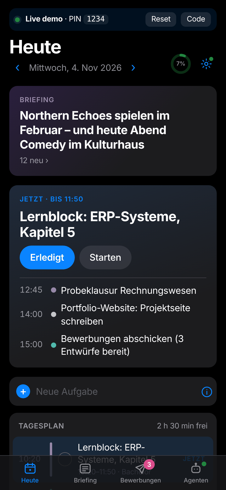
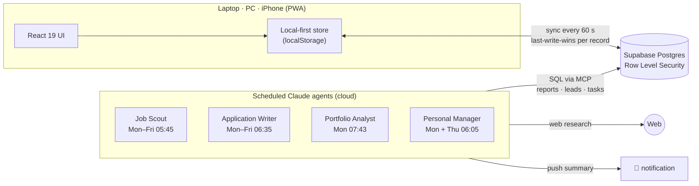

<div align="center">

# JARVIS — personal command center with AI agents

**A day planner that respects sleep, deadlines and free time, plus four scheduled AI agents that scout jobs, draft applications, analyse a portfolio and write a personal briefing.**
I built it for myself and use it every day on laptop and iPhone.

[**Live demo →**](https://jarvis-command-center.vercel.app) &nbsp;·&nbsp; fictional data, no login, portfolio PIN `1234`




</div>

## Why

My bottleneck was never time. It was organisation and follow-through. Every week I had to juggle a bachelor's exam, a job search and a side business. JARVIS takes that load off me:

- **One plan per day** that already knows my constraints: sleep, lunch, training, evenings off, locked weekends.
- **Agents do the legwork overnight.** In the morning there are ranked job leads with finished drafts, a portfolio report with deadlines, and a short briefing.
- **I stay in control.** Nothing is moved, sent or bought automatically. The system warns and proposes options, and I decide.

## What it does

| | |
|---|---|
| **Today** | Time-blocked plan with a "now" card, three daily goals, deadlines and progress. Quick add parses `CV anpassen 90m #job !1 morgen` (title, duration, category, priority, day). |
| **Planner engine** | Splits tasks into focus blocks (max. 90 min, then a break) and works around lunch, recurring blocks and fixed appointments. Buffer slots are used only when the day overflows. Detects overload and endangered **hard deadlines**, then offers 2–3 options ("move to Thu", "work until 20:00", "split"). |
| **Job Scout** (agent) | Searches job boards and career pages every weekday at 05:45. Scores each lead 0–100 against my profile, marks matched and missing keywords, and flags deadlines and the application channel. Learns from what I apply to, archive or reject. |
| **Application Writer** (agent) | Writes an email, a one-page cover letter and CV hints for the best leads, using **only facts from my profile**. It also books a fixed application slot in the planner. I review and send myself: one click opens a pre-filled mail, or the portal with the letter copied. |
| **Portfolio Analyst** (agent) | Weekly report covering analyst consensus, insider trades, sentiment and the delta to last week. Keeps facts, interpretation and options separate. Not investment advice. Amounts stay hidden behind a PIN privacy screen. |
| **Personal Manager** (agent) | Twice a week: news, events for the next 7 days and concerts that match my taste. It learns from ♡ / ☆ / ✕ reactions, and "add to plan" turns an event into a protected leisure block. |
| **Everywhere** | Installable PWA, works offline and syncs laptop, PC and phone. Dark, iOS-style UI. |

<table>
<tr>
<td width="50%"></td>
<td width="50%"></td>
</tr>
<tr>
<td><sub>Lead with match score, keyword check, drafted mail and cover letter (PDF export without app branding)</sub></td>
<td><sub>Weekly portfolio report: decisions with deadline, changes vs. last week, top and warning signals</sub></td>
</tr>
<tr>
<td></td>
<td align="center"></td>
</tr>
<tr>
<td><sub>Briefing: 7-day event strip, filters, reactions that train the agent</sub></td>
<td align="center"><sub>Same app as an iPhone PWA</sub></td>
</tr>
</table>

> The UI is German because it is my daily tool. Code, docs and this demo's framing are in English.

## Architecture



- **No backend code.** The browser talks to Supabase directly. Security lives in the database: every table has RLS bound to `auth.uid()`, sign-ups are disabled, and the public `anon` role has **no privileges at all** ([`supabase/security.sql`](supabase/security.sql)).
- **Agents are scheduled Claude tasks.** They read their instructions, the user's "focus" and last week's report, research the web, then write structured JSON into `agent_reports`, `job_leads` and the planner's `items` table. The app just renders what they produce.
- **The demo** swaps the Supabase client for an in-memory implementation of the same query-builder API ([`src/demo/client.ts`](src/demo/client.ts)), so every screen runs the production code path on fictional data.

## Engineering highlights

- **Constraint-based day planner** ([`src/lib/planner.ts`](src/lib/planner.ts)) is pure and fully unit-tested. It handles sleep and lunch, focus-block splitting, recurring blocks by weekday, buffer slots, fixed-time blockers, weekend locks, per-day exceptions and dependency ordering. Its fit check returns concrete alternatives instead of silently rescheduling.
- **Offline-first sync** ([`src/lib/sync.ts`](src/lib/sync.ts)): records carry client `updatedAt` plus a server timestamp set by a Postgres trigger that rejects stale writes. Pulls are incremental, pushes are batched, merges are per record. Daily local snapshots and JSON backup/restore are included.
- **Agent protocol** ([`docs/agents.md`](docs/agents.md)), the rules every agent follows:
  - idempotent per period
  - creates tasks only after a capacity check
  - never stacks tasks
  - deltas against the previous run
  - "exam mode" that shortens everything before an exam
  - small, verified writes
  - never sends anything on the user's behalf
- **Defensive parsing of LLM output**: agent JSON is validated and clamped field by field before rendering (URLs restricted to http(s), markdown rendered without raw HTML), so a malformed run can't break the UI.
- **Privacy by design**: the portfolio PIN is stored as a salted PBKDF2-SHA256 hash, auto-checks after the last digit and backs off after 5 failures. Amounts in headlines are masked until unlocked.
- **Performance**: route-level code splitting and separate vendor chunks. The first screen needs about 28 KB of gzipped app code; agents, briefing, settings and forms load on demand, and the service worker precaches everything for offline use.

## Tech stack

React 19 · TypeScript (strict) · Vite · vite-plugin-pwa · Supabase (Postgres, Auth, RLS) · Claude scheduled tasks + Supabase MCP · Vitest · Playwright (end-to-end checks during development) · oxlint · Vercel

## Run it

```bash
npm install
npm run dev        # starts in demo mode (no credentials needed)
npm test           # 86 unit tests
npm run build
```

To connect your own Supabase project, run the SQL files in [`supabase/`](supabase) (`schema.sql` → `agents.sql` → `jobs.sql` → `personal.sql` → `security.sql`) and set `VITE_SUPABASE_URL` and `VITE_SUPABASE_KEY` (publishable key only) as environment variables.

```
src/
  lib/          planner, sync, store, agents/jobs/briefing parsers, privacy (pure + tested)
  components/   UI (Today, Briefing, Applications, Agents, Settings)
  demo/         in-memory Supabase stand-in + fictional fixtures
supabase/       schema, RLS policies, privilege lockdown
docs/           agent protocol, screenshots
```

## How it was built

I designed the product, set the rules and reviewed every change. I test it daily in real use. The code was written in pair-programming sessions with Claude (Anthropic) as an AI engineer, which is how I believe software gets built now. The agents themselves also run on Claude.

---

**Felix Kasper** · Business & IT (MCI Innsbruck) · interested in AI, consulting and B2B sales · [LinkedIn](https://www.linkedin.com/in/felix-kasper2)
