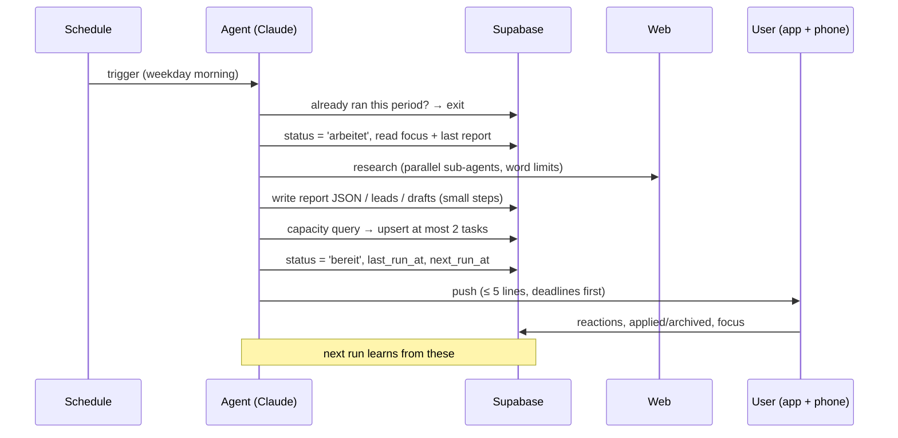

# Agent design

JARVIS runs four agents as **scheduled Claude tasks** in the cloud. They have no server of their own. Each run reads its instructions and the current state from Supabase (through the Supabase MCP connector), researches the web, writes structured results back, and sends a short push notification. The app only renders what the agents write.

The real prompts contain personal data (profile, CV, interests) and are kept private. This page describes the design they share.

## Shared protocol

Every agent follows the same contract, so adding a new one is mostly writing its research brief.

| Rule | Why |
|---|---|
| **Weekday mornings only**, never after 18:00 or on weekends | Results are ready before the work day starts, and free time stays free. |
| **Idempotent per period** (week, day or issue) | A second trigger in the same period exits without changes or notifications. The pipeline agents enforce this in the data with unique `dedup_key`s instead of report checks. |
| **Read last run first** | Reports lead with *changes since last time* instead of repeating themselves. |
| **Focus overrides defaults** | The user can steer every agent from the app ("this week only B2B SaaS"). The focus never overrides the protocol. |
| **Capacity check before creating tasks** | Agents may add tasks to the planner only if the day has room (net task minutes vs. booked minutes, weekends locked). If a task doesn't fit, they report options instead of booking it. |
| **No stacking** | An open "read the report" task is updated, not duplicated. Unprocessed drafts count towards the daily target. The scout slows down when 30+ leads are unprocessed. |
| **Exam mode** | When a hard exam deadline is ≤ 35 days away, reports get shorter, reading tasks take 10 minutes, and no extra work is created. |
| **Facts / interpretation / options** | These are kept apart, especially for the portfolio. The agent offers signals and options with pros and cons, never buy/sell instructions. |
| **Nothing invented** | Writers use only facts from the profile table. Missing data is reported as "not found", and assumptions are labeled. |
| **Never act on the user's behalf** | No logins, no sending, no trading. The app opens a pre-filled email or the portal, and the human clicks send. |
| **Small, verified writes** | Results are saved in several small `UPDATE … WHERE` steps rather than one huge statement. A failed step sets `status = 'fehler'` with a reason instead of failing silently. |

## Run lifecycle



## Data contracts

Agents write JSON that the app parses **defensively**: every field is optional, type-checked and length-clamped, URLs must be http(s), and markdown is rendered without raw HTML. A broken run degrades to fewer fields; it can't break the UI.

```jsonc
// agent_reports.data (portfolio analyst)
{
  "as_of": "2026-11-02",
  "mode": "kurz",                      // short mode before the exam
  "headline": "Portfolio +11.7 % – software carries, consumer weak",
  "changes":   [{ "name": "Portfolio", "change": "+1.9 % vs. last week" }],
  "decisions": [{ "name": "…", "what": "Tender offer: accept or hold", "deadline": "2026-11-13", "options": "…" }],
  "positions": [{ "name": "…", "signal": "positiv", "consensus": "22 of 27 buy", "price_target": "…", "insider": "…" }],
  "top_positive": [{ "name": "…", "reason": "…" }],
  "top_negative": [{ "name": "…", "reason": "…" }],
  "risks": ["Concentration risk tech 41 %"],
  "sources": [{ "title": "…", "url": "https://…", "date": "2026-11-01" }]
}
```

```jsonc
// job_leads row (scout fills the lead, writer fills the drafts)
{
  "company": "…", "title": "…", "location": "Munich",
  "match_score": 88,
  "keywords": [{ "term": "B2B sales", "matched": true }, { "term": "Salesforce", "matched": false }],
  "apply_channel": "email",            // email | portal | linkedin
  "deadline": "2026-11-16",
  "why_fit": "…", "pre_info": "salary band, CV language, …",
  "status": "entwurf",                 // neu → entwurf → beworben → interview | absage | verworfen
  "email_subject": "…", "email_body": "…", "cover_letter_md": "…", "cv_highlights": "…"
}
```

## Learning loop

- **Job Scout** reads what the user did with past leads: applied, interview, rejected, archived with a reason, deleted. It keeps a short "learned preferences" note (≤ 900 characters) on the profile and re-scores open leads. Hard rules in the prompt, like locations or no remote-only roles, always win over learned preferences.
- **Personal Manager** learns from ♡ / ☆ / ✕ reactions and free-text wishes. It maintains a ≤ 600-character summary of what lands well. Interests themselves are only ever changed by the user.

## Adding an agent

1. Insert a row into `public.agents` (id, name, role, schedule).
2. Write the prompt: research brief + this protocol + the JSON contract.
3. Create the scheduled task (weekday mornings, push on, auto-approve so unattended runs don't hang on permissions).
4. The app picks it up automatically in the Agents tab.
